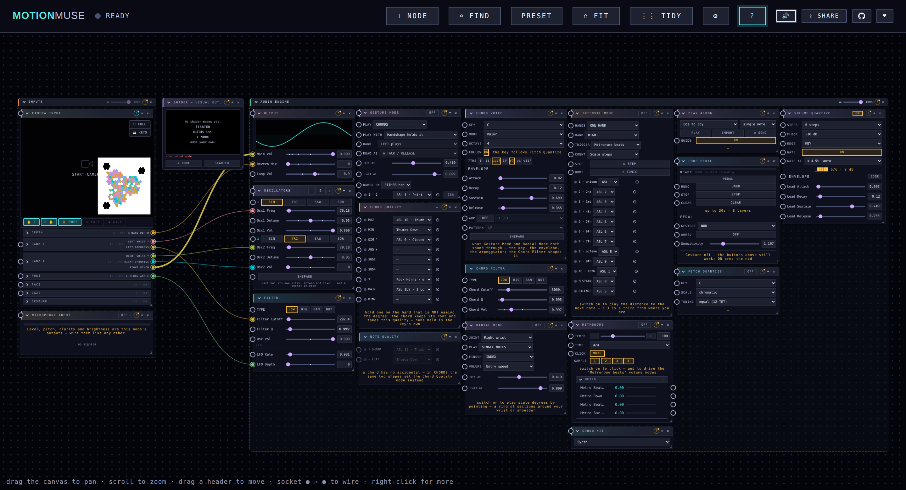

# MotionMuse

MotionMuse is a browser-based instrument that turns movement into sound. It
tracks your hands and body with a webcam, then lets you connect those signals
to a synthesizer and visual effects in a node-based workspace. No plugins or
installation are needed to use the app.



## Try it

The app needs to be served from a local web server; opening `index.html` as a
file will not work because it uses JavaScript modules.

```bash
python3 -m http.server 8080
```

Open <http://localhost:8080>, then:

1. Click **START CAMERA** and allow camera access.
2. Open **PRESET** and choose a starting patch, such as **Hands**.
3. Move in front of the camera to control the sound. Press **Space** or use the
   speaker button to mute.

Browsers may wait for a click or tap before starting audio. Camera access
requires **HTTPS** or `localhost`.

## What you can do

- Map hand, pose, face, gaze, microphone, and metronome signals to sound
  controls.
- Build and edit patches by connecting nodes with cables; adjust ranges,
  curves, and quantisation.
- Play in several ways, including hand gestures, radial controls, chords,
  arpeggios, and the play-along mode.
- Save and load setups, share them, and keep working offline after the app has
  loaded.

Face and gaze tracking are optional. The first use of tracking downloads the
required vision models, so it may take a little while to start.

## Requirements

Use a current browser with camera and WebGL support. Grant camera permission
when prompted, and run the app over HTTPS or from `localhost` for the camera to
work.

## Development

There is no bundling step. To install the development dependencies and run the
main checks:

```bash
npm install
npm run lint
npm run test:unit
npm run test:contrast
npm run test:layout
npm run test:launch
npm run test:sw
```

To test on a phone, use `npm run serve:mobile` after installing dependencies;
it serves the app over HTTPS on your local network.

## Project layout

| Path | Purpose |
| --- | --- |
| `index.html` | App entry point |
| `src/` | Audio engine, tracking, signal mapping, and UI |
| `css/` | App styles and themes |
| `tests/` | Unit and browser-based checks |
| `scripts/` | Development and screenshot tools |
| `docs/` | Demo screenshot and script |

Deploy the repository root as a static site. Netlify uses `netlify.toml` to
stamp the deployed commit; no asset bundling is required.

## Support

If MotionMuse is useful to you, you can support its development through
[GitHub Sponsors](https://github.com/sponsors/Dentarthurdent42),
[Ko-fi](https://ko-fi.com/mathieu71673), or
[Buy Me a Coffee](https://buymeacoffee.com/dentarthurdent).
